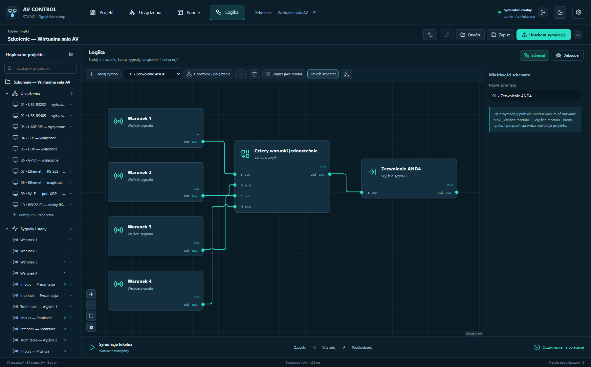
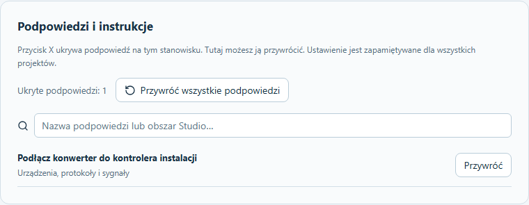
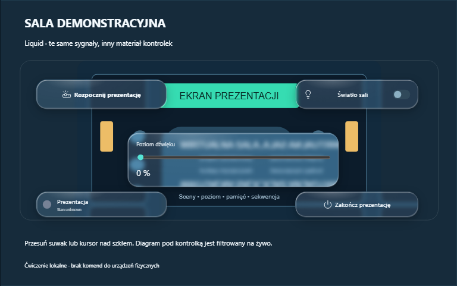
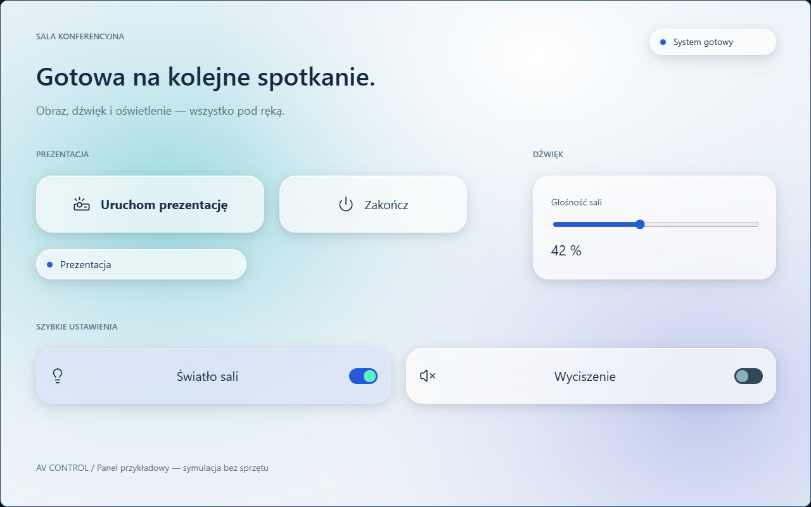
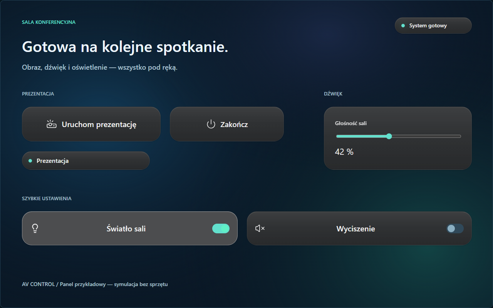
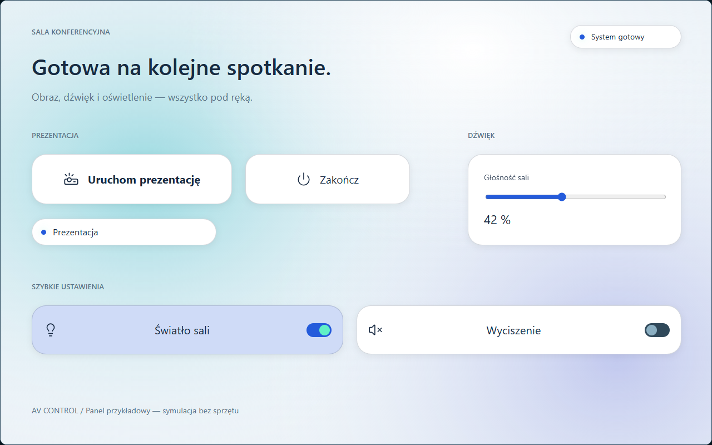

<picture>
  <source media="(prefers-color-scheme: dark)" srcset="media/logo-light.svg" />
  
</picture>

# Jedna instalacja. Twoje urządzenia. Twoja logika.

Projektuj panele, podłączaj urządzenia i programuj instalację lokalnie.

**Polski · [English](README.en.md)**

[**Pobierz 1.6.8 — Signal Workshop**](https://github.com/Gartom91/av-control-studio/releases/tag/v1.6.8) · [Historia wydań](CHANGELOG.md) · [Kurs offline](https://github.com/Gartom91/av-control-studio/releases/download/v1.6.8/AV-Control-Szkolenie-1.6.8.zip)

**Windows · Raspberry Pi 3B / 4B / 5 · Player Linux · Panele WWW**

---

AV Control to konfigurowalna platforma do sal AV, wystaw i innych instalacji. Definiujesz urządzenia, protokoły, panele i logikę; Raspberry Pi wykonuje projekt samodzielnie po zamknięciu Studio. Codzienne sterowanie działa lokalnie, bez chmury i internetu.

To **oficjalne repozytorium dystrybucyjne**: instalatory, obrazy kontrolera, aktualizacje, instrukcje i raporty weryfikacji. Źródła i historia rozwoju produktu znajdują się w osobnym prywatnym repozytorium. Automatyczne archiwa „Source code” GitHub zawierają dokumentację tego repozytorium dystrybucyjnego.

<picture>
  <source media="(prefers-color-scheme: light)" srcset="media/studio-light.png" />
  
</picture>

*Rzeczywiste zrzuty aplikacji. Przykłady używają wirtualnych transportów i wyłączonych połączeń sprzętowych.*

## Wybierz aplikację

| Aplikacja | Zastosowanie | Pobierz 1.6.8 |
| --- | --- | --- |
| **Studio** | Urządzenia, protokoły, panele i logika; symulacja, debugger i publikowanie. | [Windows x64](https://github.com/Gartom91/av-control-studio/releases/download/v1.6.8/AV-Control-Studio-1.6.8-Windows-x64.exe) |
| **Player** | Obsługa opublikowanych paneli na osobnym komputerze, także w pełnym ekranie. | [Windows x64](https://github.com/Gartom91/av-control-studio/releases/download/v1.6.8/AV-Control-Player-1.6.8-Windows-x64.exe) · [Linux .deb](https://github.com/Gartom91/av-control-studio/releases/download/v1.6.8/AV-Control-Player-1.6.8-Linux-all.deb) · [Archiwum Linux](https://github.com/Gartom91/av-control-studio/releases/download/v1.6.8/AV-Control-Player-1.6.8-Linux.tar.gz) |
| **Imager** | Wybór modelu RPi, ustawienia kont i sieci, zapis i weryfikacja karty SD. Obraz jest dołączony. | [Windows x64](https://github.com/Gartom91/av-control-studio/releases/download/v1.6.8/AV-Control-Imager-1.6.8-Windows-x64.exe) |
| **Kontroler RPi** | Samodzielne wykonywanie logiki i komunikacja z urządzeniami. | [Obraz SD, ARM64](https://github.com/Gartom91/av-control-studio/releases/download/v1.6.8/AV-Control-RPi-1.6.8-arm64.img.xz) · [Aktualizacja Runtime](https://github.com/Gartom91/av-control-studio/releases/download/v1.6.8/AV-Control-Runtime-1.6.8-arm64.zip) |
| **TAB5 ST7123** | Natywny panel operatora M5Stack: parowanie, biblioteka SD i aktualizacja przez Wi‑Fi. | [Pierwsze wgranie USB](https://github.com/Gartom91/av-control-studio/releases/download/v1.6.8/AV-Control-TAB5-ST7123-0.3.0.zip) · [Aplikacja OTA](https://github.com/Gartom91/av-control-studio/releases/download/v1.6.8/AV-Control-TAB5-ST7123-0.3.0-OTA.bin) |
| **Panel WWW** | Obsługa tych samych paneli na komputerze, tablecie lub telefonie. | Otwórz adres HTTPS kontrolera. |

Windows: Windows 10 22H2 / Windows 11, x64; .NET i instalator WebView2 offline są dołączone. Publiczny Player Linux: Debian 13 / CPython 3.13 z GTK i WebKit. Obraz RPi: Raspberry Pi OS Lite 64-bit. Pakiet Runtime służy do aktualizacji istniejącego kontrolera AV Control.

## Przejścia stron w 1.6.8

**Fade, wipe, wash, slide i zoom** mają wspólny podgląd i ustawienia dla Studio, Playera, WWW, HDMI oraz TAB5. Efekt przypisuje się do strony docelowej. Można wybrać czas, kierunek, tempo i kolor przejścia wash. Istniejące pięć stron „Wirtualnej sali AV” demonstruje poszczególne animacje.

[Ustawienia i ćwiczenie](docs/PRZEJSCIA-STRON-PL.md) · [Informacje o 1.6.8](docs/releases/v1.6.8.md) · [Weryfikacja wydania](docs/WERYFIKACJA-1.6.8.md).

Aktualizuj kontroler z panelu WWW; TAB5 wymaga firmware **0.3.0** i ponownego wysłania panelu. Bieżący program szkolenia uzupełnia zachowany, zweryfikowany PDF z 18 października.

## Poprawki 1.6.7 po audycie

Wydanie usuwa **wszystkie 25 ustaleń audytu z 18 października**: ochronę edycji i zapisu plików, obsługę dotyku i klawiatury, powrót do panelu po logowaniu, błędy logiki i protokołów, odtwarzanie aktualizacji oraz trzy problemy bezpieczeństwa. Dodano testy regresji, a TAB5 otrzymuje firmware **0.2.5** z obsługą kontrolek powiązanych tylko z akcją i wymogiem odblokowania konfiguracji przed zmianami przez USB.

[Pełna lista 25 poprawek i sposób aktualizacji](docs/releases/v1.6.7.md#polski) · [Powiązanie ustaleń z testami](docs/AUDYT-NAPRAWY-1.6.7.md) · [Wyniki i granice weryfikacji](docs/WERYFIKACJA-1.6.7.md).

## HDMI i M5Stack TAB5

**Od 1.6.6:** poprawka rysowania kiosku HDMI usuwa poziome pasy. Właściciel potwierdził czytelny obraz na RPi 4B i monitorze 2560 × 1440 po zastosowaniu poprawki na 1.6.5.

TAB5 ST7123 rysuje panel lokalnie; malina wykonuje logikę. Studio 1.6.8 obsługuje jednorazowy kod parowania i pełny odcisk certyfikatu, wysyłanie wybranych stron, do 32 nazwanych paneli na FAT/exFAT oraz aktualizację firmware 0.3.0 przez Wi‑Fi. Wysuwana belka udostępnia wybór panelu, jasność i dźwięk. Sterowanie z kopii SD wymaga połączenia i sprawdzenia panelu na kontrolerze. Pierwsze wgranie wymaga USB; OTA używa wyłącznie pliku aplikacji.

[Instrukcja TAB5](docs/TAB5-PL.md) · [Odbiór prototypu na sprzęcie](docs/WERYFIKACJA-TAB5.md) · [Potwierdzona poprawka HDMI](docs/WERYFIKACJA-HDMI-2026-10-12.md). Firmware 0.3.0 przeszedł aktualizację Wi-Fi na fizycznym TAB5, kontrolę startu i zachowania sześciu paneli; właściciel potwierdził brak błysków podczas aktualizacji. Osobno dokumentujemy testy animacji i fizycznego dotyku w raporcie 1.6.8.

*Rzeczywista pamięć obrazu TAB5 ST7123 z firmware 0.2.3; odrębny panel Sala z 12 elementami. W podręczniku jest też Laboratorium z 19 elementami.*

## Ukrywanie podpowiedzi

**Od 1.6.5:** przycisk **X** ukrywa 100 rodzajów podpowiedzi i bloków instrukcji. Studio zapamiętuje wybór na tym stanowisku dla wszystkich projektów, również po restarcie. W **Ustawienia → Podpowiedzi i instrukcje** wyszukasz i przywrócisz jeden blok albo przywrócisz wszystkie.

## Signal Workshop

- **Bieżący podgląd logiki:** przeliczenie po zmianach i co około 200 ms, bez publikowania; niezależna pamięć i reset podglądu.
- **Rzetelny stan komunikacji:** gotowość gniazda UDP lub portu szeregowego jest odróżniona od aktualnej odpowiedzi; TCP korzysta z systemowego keepalive.
- **Powitanie i metryka projektu:** osobny ekran startowy, dane instalacji/klienta/zespołu/serwisu, lista odbiorowa i historia.
- **Autonomiczna diagnostyka:** stan kontrolera, awarie komunikacji, brak odpowiedzi i incydenty; opcjonalne raporty i popup w TECHNIKAV oraz czteroetapowy kreator Proton Mail, szyfrowany token SMTP i konfigurowani odbiorcy.
- **Wprowadzanie tekstu:** klawiatura ekranowa domyślnie ukryta na PC/WWW, a włączona na lokalnym HDMI. Włączysz ją lokalnie w Ustawieniach, Moje konto lub ustawieniach logowania.
- **Tła panelu:** upload z inspektora, gradienty, kadrowanie/skala/pozycja/kafelki i narożniki 9-slice; wspólny wygląd edytora i operatora.
- **Panel lokalny HDMI:** automatyczny kiosk na Raspberry Pi, mysz/touchpad/dotyk USB, strona początkowa i konsola tty2. [Instrukcja i ćwiczenia](docs/PANEL-HDMI-PL.md).
- **Jeden obszar logiki:** urządzenia, sygnały, protokoły, komendy, sekwencje i Python we wspólnym eksploratorze z ustawieniami kontekstowymi. Nazwa i ikona urządzenia opisują rzeczywisty sprzęt.
- **Czytelne schematy:** porty wyrównane z opisami, prowadzenie przewodów wokół symboli, rozdzielanie tras i oznaczanie przecięć. Bramki o zmiennej liczbie wejść, Truth table, impulsowy Interlock z SET ALL/CLEAR, timery, liczniki, pamięci, zatrzaski i przerzutniki.
- **Pełny Python:** edytor kodu, typowane porty, stan, parametry, moduły pomocnicze i dokładne wersje bibliotek. Import NumPy i innych bibliotek, instalacja z PyPI lub zgodnych wheel offline oraz próba w Studio. Administrator zatwierdza konkretny kod, helpery i wymagania; zmiana unieważnia zgodę. Pełny CPython wykonuje zaufany kod i nie jest piaskownicą bezpieczeństwa.
- **Wybór projektu:** wyszukiwanie, pełne nazwy i znacznik bieżącego projektu w dopasowanej do motywu liście; strzałki, Enter i Escape. Konto, motyw i ustawienia pozostają po prawej.
- **Debugger:** wartości i jakość sygnałów, pamięci, timery, sekwencje, TX/RX, ślad zdarzeń i przyczyny blokad. Wymuszanie wejść oraz pauza/krok logiki w symulatorze. Pauza nie zamraża komunikacji, trwających sekwencji ani procesów Python. Regulowany podział w czterech położeniach, pełny obszar roboczy i osobne okno z zachowaniem sesji.
- **Codzienna edycja:** prawy klik i skróty do wycinania, kopiowania, wklejania, duplikacji, usuwania, zmiany nazwy, wyrównywania, grup, warstw, kopiowania wyglądu, blokowania pozycji i przechodzenia do końców połączenia.
- **Własny wygląd:** jasny, ciemny i systemowy motyw programu, dopasowane przewijanie oraz osiem motywów paneli z dostrajaniem poszczególnych elementów.

*Jeden przykładowy panel, jeden układ i te same powiązania. Liquid filtruje rzeczywiste tło pod kontrolkami. To zrzut działającego panelu, z wirtualnymi sygnałami i bez komend sprzętowych.*

Porównaj Frost, Soft Dark i Paper

**Frost** — jasne, rozproszone powierzchnie nad spokojnym tłem.

**Soft Dark** — subtelnie wypukłe przyciski i ciemne gradienty.

**Paper** — jasny, oszczędny wygląd i wyraźna typografia.

[Pobierz edytowalny projekt demonstracyjny](media/Sala-konferencyjna.avctrl) — cztery strony o tym samym układzie; otwórz w Studio 1.6.0 lub nowszym i uruchom symulację. Projekt zawiera wyłącznie wirtualne sygnały, bez urządzeń, akcji i poleceń startowych. [Raport renderowania](media/panel-showcase-verification.json).

[Instrukcja wyboru projektu ze zrzutami](docs/WYBOR-PROJEKTU-PL.md)

## Połączenia i automatyzacja

| Obszar | Funkcje |
| --- | --- |
| **Porty szeregowe i GPIO** | USB–RS232/RS485, UART RPi i cyfrowe GPIO; stabilne identyfikatory USB, wykrywanie linii, konflikty, format transmisji, kontrola przepływu i kierunek RS485. UART jest domyślnie włączony w czystym obrazie bez konsoli szeregowej. |
| **Rozbudowa sieci** | Klient/nasłuch TCP, UDP, dodatkowe adaptery USB–Ethernet na malinie oraz ekspandery Ethernet/Wi-Fi z ustawieniami kanałów, TCP/UDP i standardowym RFC2217, jeśli sprzęt go obsługuje. Presety wyjaśniają Unitek Y-105, USR-W610 i CH343P TTL. |
| **Własne protokoły** | ASCII/UTF-8/HEX, parametry, końce/długości ramek, kolejność bajtów, SUM/XOR/CRC, pola odpowiedzi, mapowanie stanów, komunikaty spontaniczne i odpytywanie. Profile wielokrotnego użytku z osobnymi adresami instalacji. |
| **Panele WYSIWYG** | Strony, przyciski, przełączniki, fadery, slidery, pokrętła, wartości, kontrolki, tekst i grafiki z dysku; opcjonalne etykiety, ramki, rogi, CSS i warianty PC/tablet/telefon. Edytor i operator używają wspólnego renderera. |
| **Akcje i sekwencje** | Oczekiwanie, timeouty i anulowanie; zezwolenia oraz wzajemne wykluczanie sprawdzane przez silnik dla API i wielu paneli. Jakość sygnału rozróżnia wartości poprawne, przeterminowane, nieznane i błędne. |
| **Publikowanie i praca** | Walidacja, przygotowanie, aktywacja, historia/przywracanie, role administrator/operator, HTTPS i przypięcie certyfikatu. Ustawienia RPi przez WWW z potwierdzeniem/powrotem sieci. Od 1.6.4 aktualizacje sprawdzają podpisany manifest i SHA256; RPi wraca do poprzedniej wersji po błędzie uruchomienia. |

Nie ma stałego limitu liczby urządzeń, stron ani bloków. Praktyczna pojemność zależy od kontrolera i obciążenia. Jeden kontroler wykonuje jeden aktywny projekt; Studio przechowuje wiele projektów i połączeń z kontrolerami.

## Zacznij bez sprzętu

1. Zainstaluj **Studio**. Lokalny symulator loguje właściciela automatycznie przy użyciu prywatnego poświadczenia zabezpieczonego przez Windows; wspólne hasło `admin` / `simulation` zostało usunięte. Po wylogowaniu wybierz **Otwórz lokalny symulator**. Zmienione własne hasło wpisz w zwykłym formularzu logowania.
2. Wybierz **Otwórz projekt szkoleniowy** oraz **Podręcznik szkoleniowy**.
3. Sprawdź przykłady i wybierz **Uruchom symulację**. Przed włączeniem transportów fizycznych zdefiniuj własne polecenia sprzętu.
4. Przygotuj SD aplikacją **Imager**; przed jej wymazaniem potwierdź wybrany nośnik.
5. W **Ustawienia → Użytkownicy** utwórz operatora z własnym hasłem. Opublikuj projekt i użyj tego konta w **Playerze** albo panelu WWW kontrolera; poświadczenie właściciela Studio nie jest hasłem do wpisywania w Playerze.

## Pierwsze uruchomienie Raspberry Pi

Po przygotowaniu karty w **AV Control Imager** i pierwszym starcie domyślny adres to **https://av-control.local:8443/**. Własna nazwa, np. `sala-a`, daje **https://sala-a.local:8443/**. IP przydziela DHCP; obraz nie ma stałego adresu `192.168.1.23`.

Zaloguj się do WWW jako **`admin`** hasłem ustawionym w Imagerze. **`avoperator`** jest odrębnym kontem Linux/SSH. Odczytaj `AV-Control-parowanie.txt` i `AV-Control-CA.crt` z partycji boot po zakończeniu pierwszej konfiguracji: Studio/Player używają adresu i odcisku, przeglądarka wymaga zaufania właściwemu CA i zgodności nazwy certyfikatu. Następnie opublikuj pierwszy projekt; nowa karta oczekuje na panel.

[**Pełna procedura first-run**](docs/PIERWSZE-URUCHOMIENIE-PL.md) — Imager, sieć i DHCP, certyfikaty, konta, publikowanie, logowanie i HDMI/USB, aktualizacje, opcjonalny TECHNIKAV oraz rozwiązywanie problemów.

## Nauka i weryfikacja

**Rewizja szkolenia: 18 października 2026, dołączona do AV Control 1.6.7.** Główny **217-stronicowy podręcznik** obejmuje **55 rozdziałów i cztery dodatki**, z **80 ilustracjami ekranów i trzema diagramami**. Program zawiera **10 sesji / 22 godziny** oraz opcjonalne moduły: **HDMI (60 minut)** i **TAB5 (90 minut)**.

- [Kurs offline](https://github.com/Gartom91/av-control-studio/releases/download/v1.6.8/AV-Control-Szkolenie-1.6.8.zip) — podręcznik HTML/PDF, program szkolenia, ilustracje i neutralne przykłady.
- [PDF: 217 stron](https://github.com/Gartom91/av-control-studio/releases/download/v1.6.8/AV-Control-Studio-Tutorial-PL-Signal-Workshop.pdf) · [Program szkolenia, Markdown](https://github.com/Gartom91/av-control-studio/releases/download/v1.6.8/PROGRAM-SZKOLENIA-PL.md).

Poprawiony podręcznik jest dołączony do instalatorów 1.6.7, obrazu Raspberry Pi, archiwum dokumentacji i kursu offline. Pobranie samego kursu nie aktualizuje oprogramowania. Wszystkie 80 zrzutów zachowano jako jawnie historyczne ilustracje z 11–12 października, z ich pierwotnymi wersjami i dowodami. Tekst 1.6.7 opisuje nowe logowanie, blokadę konfiguracji USB oraz poprawiony odczyt pól protokołu; nie przedstawia tych ilustracji jako nowych prób 1.6.7.

- [Pełna dokumentacja](https://github.com/Gartom91/av-control-studio/releases/download/v1.6.8/AV-Control-Studio-1.6.8-Dokumentacja.zip) · [Python](https://github.com/Gartom91/av-control-studio/releases/download/v1.6.8/SYMBOLE-PYTHON-PL.md) · [USB, RS485 i UART](https://github.com/Gartom91/av-control-studio/releases/download/v1.6.8/USB-RS485-UART-PL.md) · [Ekspandery](https://github.com/Gartom91/av-control-studio/releases/download/v1.6.8/EKSPANDERY-SIECIOWE-PL.md).
- [Raport weryfikacji](https://github.com/Gartom91/av-control-studio/releases/download/v1.6.8/WERYFIKACJA-1.6.8.md) · [Manifest budowania i testów](https://github.com/Gartom91/av-control-studio/releases/download/v1.6.8/RELEASE-MANIFEST.json) · [Podpis ECDSA](https://github.com/Gartom91/av-control-studio/releases/download/v1.6.8/RELEASE-SIGNATURE.json) · [Sumy SHA256](https://github.com/Gartom91/av-control-studio/releases/download/v1.6.8/SHA256SUMS.txt).

Szczegółowy kurs i interfejs są obecnie po polsku. README i opisy wydań są w obu językach; wybór znajduje się u góry.

[Fizyczna RPi 4B przeszła aktualizację GitHub 1.5.3 → 1.5.5](docs/WERYFIKACJA-RPI-1.5.5-PO-PUBLIKACJI.md), z zachowaniem projektu, ustawień, kont, sesji i certyfikatu oraz zgodnością pięciu paneli. Zakres dowodów programowych dla 1.6.7 wskazuje raport tego wydania. Fizyczna aktualizacja pełnego wydania 1.6.7 pozostaje niezweryfikowana; poprawka HDMI ma osobny, historyczny odbiór opisany wyżej. Fizyczne 3B/5, rozruch nowej karty, komunikacja elektryczna UART/RS232/RS485/GPIO, zakupione adaptery i rzeczywiste urządzenia mobilne wymagają osobnych prób sprzętowych. Instalatory AV Control nie mają obecnie podpisu Authenticode wydawcy; instalatory producentów są sprawdzane osobno.

## Dystrybucja i licencja

Pobieraj załączniki z sekcji **Assets**. Podpisany manifest zapisuje sumy paczek, wersję źródeł i dowody weryfikacji wydania. Wersja 1.6.8 dostarcza skompilowane aplikacje i dokumentację, bez ZIP-a źródeł produktu. Kod bajtowy i pakiety przeglądarkowe nie są szyfrowaniem ani gwarancją ochrony przed analizą. [Szczegóły pakowania](https://github.com/Gartom91/av-control-studio/releases/download/v1.6.8/PAKOWANIE-BINARNE-1.5-PL.md).

Aktualizator zainstalowany przed wersją 1.6.4 nie sprawdza jeszcze niezależnego podpisu podczas pierwszej aktualizacji. Wskazówki dotyczące tego przejścia są w [opisie wydania 1.6.4](https://github.com/Gartom91/av-control-studio/releases/tag/v1.6.4).

Aplikacje nadal korzystają z tego repozytorium do aktualizacji. Podział repozytoriów nie wymaga ponownego zapisu SD ani wymiany projektu. Aktualizacje online i instalacja z PyPI wymagają internetu; praca lokalna pozostaje od nich niezależna.

Wcześniejsze wydania MIT i pochodzący z nich kod zachowują [pierwotne warunki MIT](LICENSE-MIT-1.4.1.txt). MIT nie jest ogólną licencją wszystkich nowych elementów rozwijanych po 1.4.1; zobacz [zakres licencji](LICENSE). Komponenty innych autorów zachowują swoje licencje.

[Projekt przyszłej EULA](EULA-PL-PROJEKT.md) wskazuje osobę fizyczną z placeholderami danych, adresu i kontaktu. Opisuje możliwe przyszłe opłaty; nie uruchamia płatności ani nowych wiążących warunków. Licencjonowanie przez TECHNIKAV pozostaje planowaną usługą opcjonalną.

[Zgłoś błąd lub propozycję](https://github.com/Gartom91/av-control-studio/issues) · [Standard dwujęzycznych wydań](RELEASING.md) · [English](README.en.md)

- [Konta użytkowników i wysuwana klawiatura](docs/KONTA-I-LOGOWANIE-PL.md): logowanie do paneli, własne hasło, administracja i moduł szkoleniowy.
