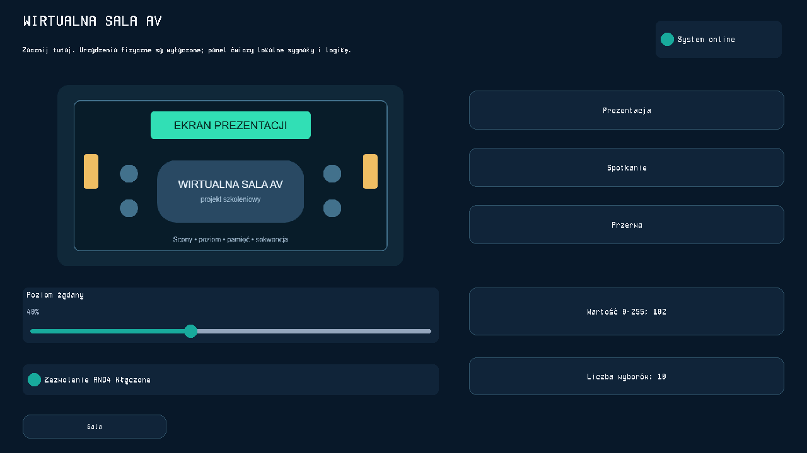
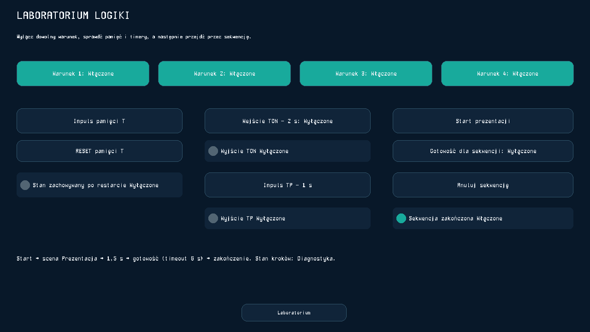

# Sprawdzenie TAB5 ST7123 — 12 października 2026

Oprogramowanie działa na fizycznym M5Stack TAB5 z ST7123, ESP32-P4 rewizji 1.3, 16 MiB flash i 32 MiB PSRAM. Firmware 0.2.3 jest dodatkiem do AV Control 1.6.5. Rozszerzenie zostało zainstalowane na malinie właściciela; oficjalne wydanie 1.6.5 pozostaje osobnym wydaniem produktu.

## Potwierdzone na urządzeniu

Właściciel potwierdził działanie ekranu, dotyku, wpisywania hasła Wi-Fi, dźwięków przycisków i gestu pięciu palców. Hasło konfiguracji ustawił samodzielnie na TAB5. Diagnostyka nie odczytuje hasła konfiguracji ani haseł sieci.

Studio na istniejącej malinie przesłało wszystkie pięć stron opublikowanego projektu. Pierwsze trzy zapisane wpisy były kopiami tego samego pełnego układu pod różnymi nazwami. Ich wybór potwierdzał odczyt dokumentu z SD i zatwierdzenie przez malinę, ale nie pokazywał wizualnej zmiany układu. Projekt, jego rewizja, konta, parowanie i certyfikat pozostały zachowane. SVG zamieniono na PNG tylko w kopii przeznaczonej dla TAB5. Projektant ma własne okno wysyłania oraz wariant 1280 × 720.

Odczyt ekranu potwierdził pełny panel 1280 × 720, 16 widocznych kontrolek na pierwszej stronie i kompletny obraz „System online”. Belka nie zajmuje miejsca w wysłanym panelu. W belce są suwaki jasności i głośności, wyłączenie ekranu i dźwięku, biblioteka SD oraz konfiguracja chroniona hasłem. Ikona baterii z procentami jest po prawej stronie Wi-Fi, w prawym górnym rogu.

Karta właściciela została rozpoznana jako exFAT o pojemności 62 549 655 552 bajtów. Nie była formatowana. Po próbie z różnymi układami zawiera pięć wpisów: trzy kopie pełnego panelu oraz dwa różne panele jednostronicowe opisane poniżej. Biblioteka jest przypisana do sparowanego kontrolera i mieści do 32 układów; po jej zapełnieniu ostatni panel nadal zapisuje się w pamięci wewnętrznej.

Test sprzętowy wykrył restart podczas zmiany panelu z SD. Ślad stosu wskazał zamknięcie operacji SPI w innym wątku niż ten, który ją otworzył. Firmware 0.2.3 kończy każdą operację na jej wątku, pod istniejącą blokadą aplikacji. Ponowny test na urządzeniu potwierdził wybór innego panelu z listy, zatwierdzenie przez malinę i powrót do „Sala — pełny panel”, bez restartu oraz z zachowaniem ustawień. Mechanizm utrzymywania operacji opisują [źródła przypiętej biblioteki SdFat 2.3.1](https://github.com/greiman/SdFat/blob/2.3.1/src/SdCard/SdSpiCard/SdSpiCard.cpp).

Układ audio jest ponownie uruchamiany po inicjalizacji urządzenia, z zachowaniem zapisanego poziomu i wyciszenia. Właściciel potwierdził dźwięki przycisków również po aktualizacji przez Wi-Fi i ponownym uruchomieniu TAB5.

## Przełączanie dwóch różnych układów

Przez rzeczywisty interfejs Studio wysłano dwa osobne panele z istniejących stron projektu:

- **Sala — sterowanie**: jedna strona „01 • Sala”, **12 kontrolek**, grafika sali, wybór sceny oraz poziom.
- **Laboratorium — testy**: jedna strona „03 • Laboratorium”, **19 kontrolek**, cztery warunki, pamięć, timery i sekwencja.

Przyciski nawigacji do niewysłanych stron są pomijane w kopii dla TAB5, z ostrzeżeniem w podglądzie. Projekt maliny i rewizja 20 pozostały zachowane. Test porównuje zawartość stron i kontrolki, a nie tylko nazwy czy sumy dokumentów.

Na fizycznym TAB5 wykonano **cztery przełączenia z biblioteki SD**, z potwierdzeniem wybranego dokumentu przez malinę. Odczyt rzeczywistego obrazu ekranu wykazał zmianę **49,38% pikseli** pomiędzy tymi układami. Na końcu pozostawiono „Laboratorium — testy”. Polecenia kontrolek i sekwencje nie były uruchamiane przez test.

## Aktualizacja przez Wi-Fi

Pierwszą instalację obsługi OTA wykonano przez USB. Następnie rzeczywiste Studio przesłało plik firmware.bin przez istniejące HTTPS na malinie i zleciło aktualizację właściwego TAB5. Urządzenie pobrało aplikację przez Wi-Fi, sprawdziło SHA-256, zapisało ją w nieaktywnym obszarze app1, uruchomiło się ponownie i potwierdziło plik oraz wersję 0.2.3 w Studio.

Była to ponowna instalacja 0.2.3 z app0 do app1. Test potwierdza cały mechanizm OTA, a nie zmianę numeru z poprzedniej wersji. Zachowały się Wi-Fi, parowanie, hasło konfiguracji, jasność 20%, głośność 20%, włączone dźwięki, aktualny panel i trzy pliki biblioteki SD. Aplikacja ma 2 402 704 bajty; sprawdzony SHA-256: `52cddeb853eb773cb951a561c7717161f1647ad69de7f751066d1f41a945129e`.

Aktualizacja zmienia tylko aplikację ESP32-P4. Nie zapisuje bootloadera, tablicy partycji, NVS, LittleFS, karty SD ani firmware radia ESP32-C6. Serwer odrzuca pliki dla innego układu i uszkodzone obrazy; wymaga administratora do dodania pliku oraz zlecenia aktualizacji. Panel pobiera tylko plik przypisany jego zleceniu i sprawdza zatwierdzony odcisk certyfikatu przed przesłaniem autoryzacji.

Nowa aplikacja potwierdza start po sprawdzeniu ekranu, dotyku, pamięci, inicjalizacji audio, własnego pliku i połączenia z kontrolerem. Przy nieudanej kontroli w ciągu 60 sekund przewidziany jest powrót do poprzedniej aplikacji. Nie wykonywano fizycznej próby odcięcia zasilania podczas zapisu ani celowego uruchomienia wadliwej aplikacji. Firmware nie ma osobnego podpisu wydania ani skonfigurowanego eFuse secure boot; autoryzację zapewniają administrator i przypięty certyfikat HTTPS, a integralność — sumy pliku.

## Płynność

Panel i grafiki są przechowywane oraz rysowane lokalnie. Połączenie ze Studio może zostać zamknięte. Malina przesyła zmienione wartości kontrolek przez stałe połączenie, z próbkowaniem 30 razy na sekundę. Przeciąganie suwaka pokazuje wartość od razu na TAB5; polecenia są łączone, a wartość końcowa wysyłana po puszczeniu palca.

Pomiary na firmware 0.2.3 obejmują częściowe przerysowanie liczbowej kontrolki na rzeczywistym panelu oraz diagnostyczny strumień po Wi-Fi. Test zmienia wyłącznie wartości w odpowiedzi diagnostycznej; nie zmienia sygnałów instalacji, nie uruchamia sekwencji i nie wysyła poleceń do urządzeń.

| Pomiar | Wynik |
| --- | --- |
| Lokalna kontrolka, 60 klatek w 907 ms | **66,15 klatki/s** |
| Czas lokalnej klatki — mediana / 95. percentyl | **15 / 16 ms** |
| Wi-Fi, 104 przerysowania w 3469 ms po rozgrzewce | **29,98 klatki/s**, około 30 |
| Pakiety diagnostyczne odebrane z maliny | **120 ze 120** |

Pierwsze otwarcie strony, odczyt biblioteki i pobranie nowego panelu obejmują większą ilość pracy. Wynik pojedynczej kontrolki nie oznacza gwarancji 30 FPS dla każdej strony ze 100 jednocześnie zmieniającymi się elementami ani dla pełnego odświeżenia ekranu.

## Testy i stan usług

- Pełny zestaw testów po poprawce paneli częściowych: **466 zaliczonych, 14 pominiętych**, dwie ostrzegawcze informacje o przestarzałych metodach z biblioteki pySerial.
- Testy interfejsu obejmują parowanie, odwołanie dostępu, wysyłanie stron, konwersję SVG, bibliotekę i OTA. Testy OTA obejmują uprawnienia, przypisanie pliku, odrzucanie uszkodzeń oraz zgodność potwierdzonej wersji i SHA-256.
- Przenośne Studio dla Windows przeszło sprawdzenie uruchomienia, DPAPI, przypięcia certyfikatu, odrzucania błędnego odcisku, innego hosta i wygasłego certyfikatu oraz weryfikację mechanizmu wydań GitHub.
- Rzeczywiście zainstalowany program maliny zakończył się przy aktywnym strumieniu HMI w **5,226 s** w osobnym teście na danych symulowanych. Zwykłe wdrożenia rozszerzenia zakończyły usługę w około sekundę.
- Kontrola monitoringu o **2026-10-11 22:16:58 UTC**: usługa aktywna, API dostępne, **0 aktywnych awarii**, brak nowych zdarzeń awarii w ostatnich 15 minutach. Powiadomienia nie zostały wyłączone.

Wcześniejszy alarm sekwencji wskazywał na przekroczenie czasu oczekiwania na warunek „ready” w „Szkolenie • Start prezentacji”. Alarm API wystąpił podczas wcześniejszego restartu usługi, która czekała na otwarte połączenie HMI. Limit zamykania takich połączeń został poprawiony. Testy płynności nie uruchamiają tej sekwencji.

## Pakiety i granice odbioru

Pakiet firmware zawiera oddzielne obrazy aplikacji, bootloadera, partycji i selektora OTA, sumy SHA-256 oraz skrypt USB. Zbiorczy obraz fabryczny i kopia pamięci pierwotnego urządzenia nie są dołączane, aby nie zastępować ustawień.

Przenośne Studio jest dodatkiem testowym do 1.6.5. Nie zainstalowano nowego oficjalnego wydania ani nie zmieniono automatycznie aplikacji zainstalowanej na komputerze właściciela. Instrukcję obsługi zawiera [TAB5-PL.md](TAB5-PL.md).
